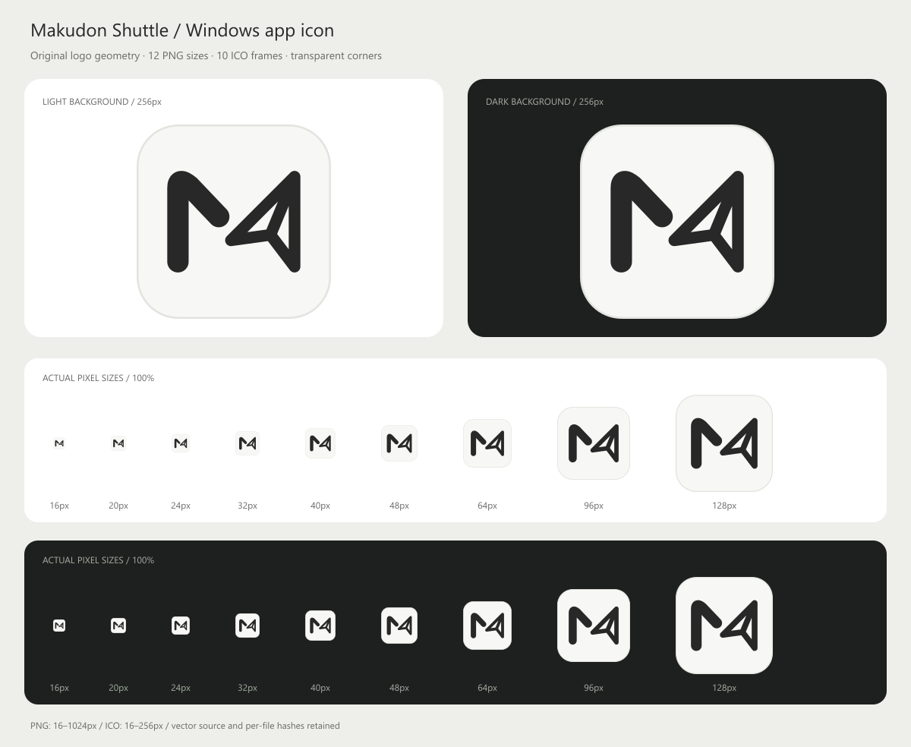

# Windows 应用图标

基于[当前主 LOGO](../../brand/source/makudon-shuttle-icon.svg)导出，保留新版 100 × 100 画布、两条路径、圆端点、线宽及组平移。所有尺寸使用同一图形，不包含文字商标。



| 文件 | 用途 |
| --- | --- |
| [makudon-shuttle.ico](makudon-shuttle.ico) | Windows EXE、快捷方式与系统图标资源；一个文件内含 10 个尺寸 |
| [makudon-shuttle-app-icon.svg](makudon-shuttle-app-icon.svg) | 平台图标矢量母版，固定配色，完整 100 × 100 画布 |
| [png/](png/) | 12 个精确尺寸的 RGBA PNG，用于窗口 / 任务栏图像加载、DPI 适配及较大尺寸展示 |
| [preview.png](preview.png) | 浅深背景的原尺寸检查图；不作为应用资源嵌入 |
| [provenance.json](provenance.json) | 主图标哈希、导出参数、格式、工具版本及逐文件 SHA-256 |

PNG 命名为 `png/makudon-shuttle-{size}.png`：**16、20、24、32、40、48、64、96、128、256、512、1024**，宽高相同。ICO 内含 **16、20、24、32、40、48、64、96、128、256**；覆盖 Windows 常用尺寸及部分 DPI 缩放尺寸。尺寸选择参考微软[图标构建](https://learn.microsoft.com/en-us/windows/apps/design/iconography/app-icon-construction)与 [Win32 图标说明](https://learn.microsoft.com/en-us/windows/win32/menurc/about-icons)。

## 外观

系统图标使用固定纸白底板 `#F7F7F5`、主图形 `#272827` 与细边框 `#E3E4DF`，圆角外部透明。底板在 100 单位画布中内缩 0.5，宽高 99，圆角 21，描边 1。图形完整保留原始留白，不裁切、不拉伸，不改路径位置；只将原 `#222222` 换成纸白主题主文字色。

系统图标不随应用主题变色，让主图形在系统浅深色背景上都可辨认。应用界面内仍使用[透明、可着色的品牌 SVG](../../brand/README.md)，不要用带底板的系统图标替代横向商标。

## 格式与再生成

每个 PNG 分别从矢量源按目标尺寸的 4 倍渲染，再以 Lanczos3 降采样，保留 8 位 RGBA，不从最大 PNG 连续缩放。ICO 的 16–128 帧使用 32 位 BGRA DIB 与 1 位 AND 蒙版，256 帧使用 RGBA PNG；各帧解码像素与对应 PNG 一致。

在已有 sharp 的设计环境、仓库根目录运行：

```powershell
node scripts/generate-windows-icons.cjs
```

脚本校验新版主图标 SHA-256，生成母版、PNG、ICO、预览与来源记录；输入变化时须检查新几何再更新固定哈希。无需 Fredoka 字体，也不引入应用运行依赖。

资源已完成独立解码、逐帧像素核对、尺寸 / 透明度检查及预览核对；当前 Windows 主机的 Win32 `LoadImageW` 已成功加载全部 10 个尺寸，返回正确宽高与 32bpp。当前没有原生程序，尚未嵌入 EXE，也未完成 Windows 10 实际窗口、任务栏与不同 DPI 的产品验收。后续集成时把 ICO 指定为 EXE 图标，并为窗口 / 任务栏设置应用身份及相应尺寸图像。当前资源面向免安装桌面程序，不包含 MSIX / Microsoft Store 专用清单资源。
